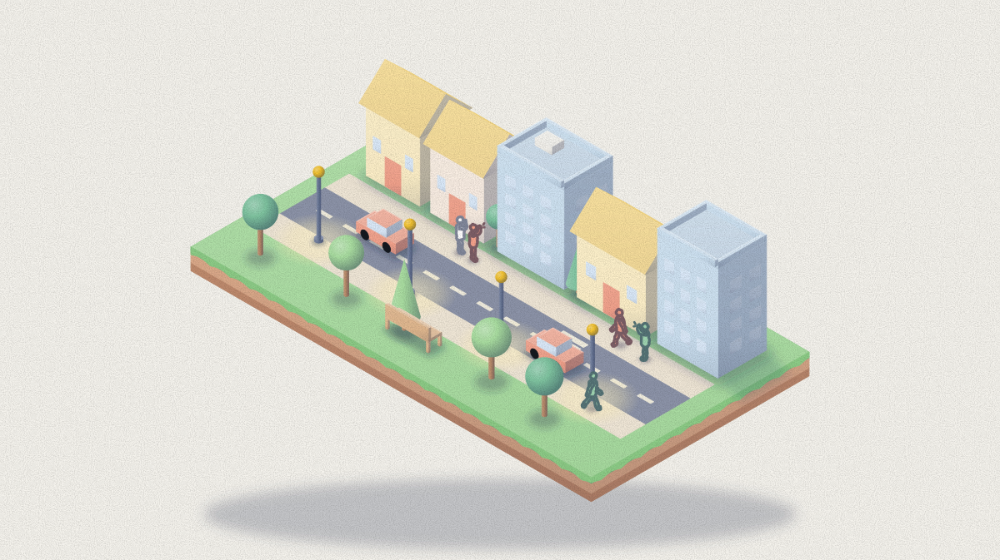
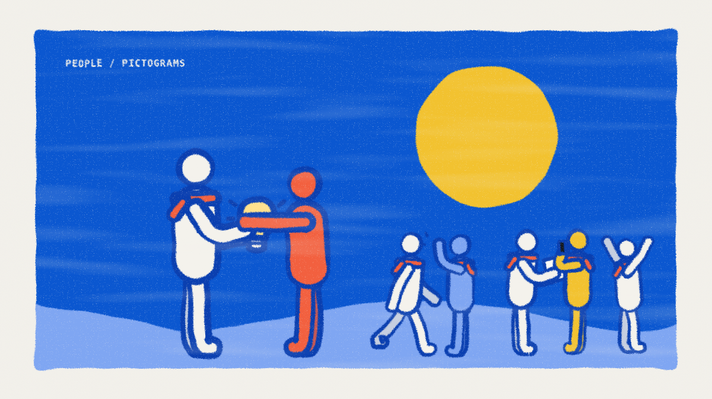
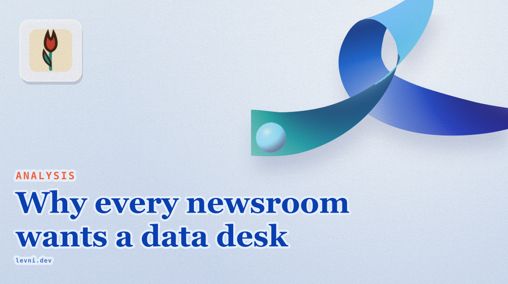
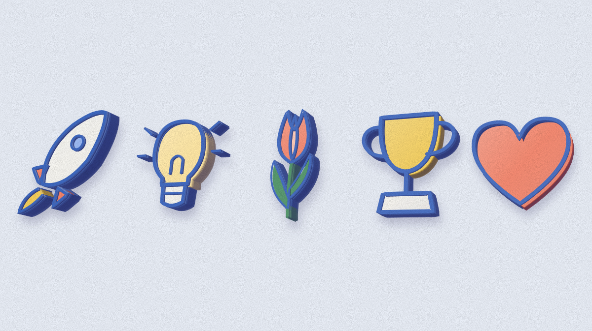
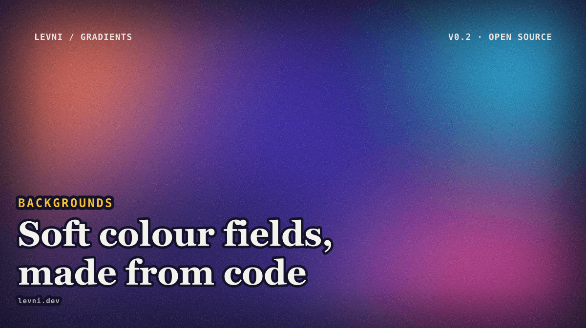
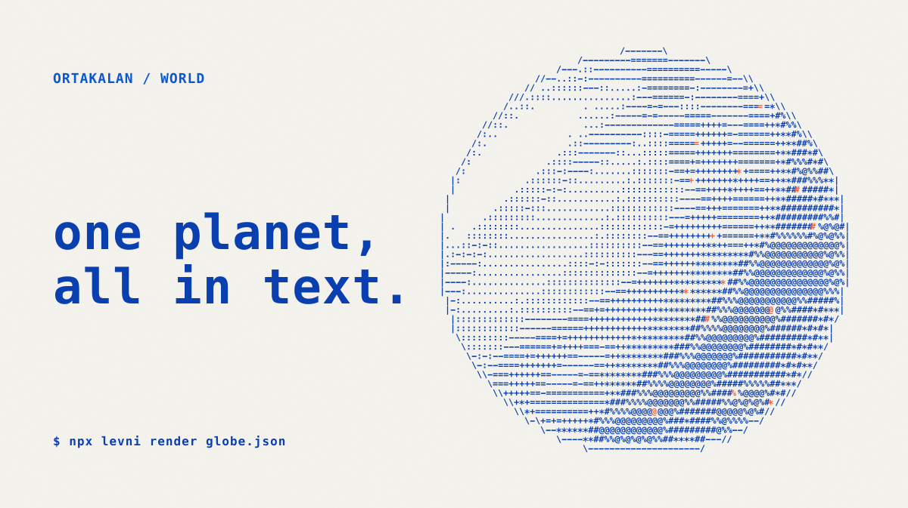
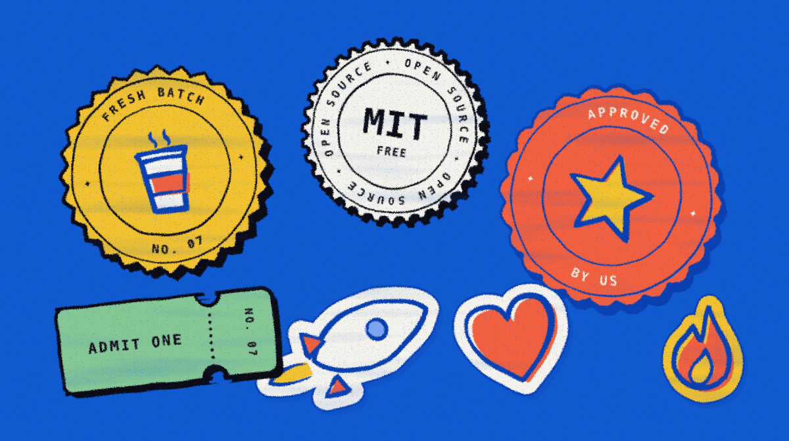
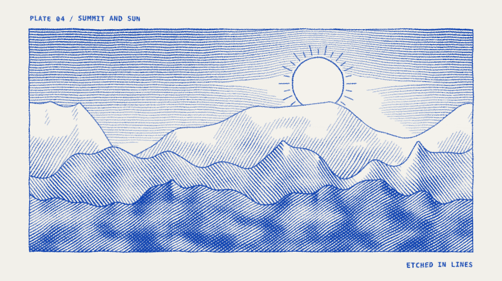
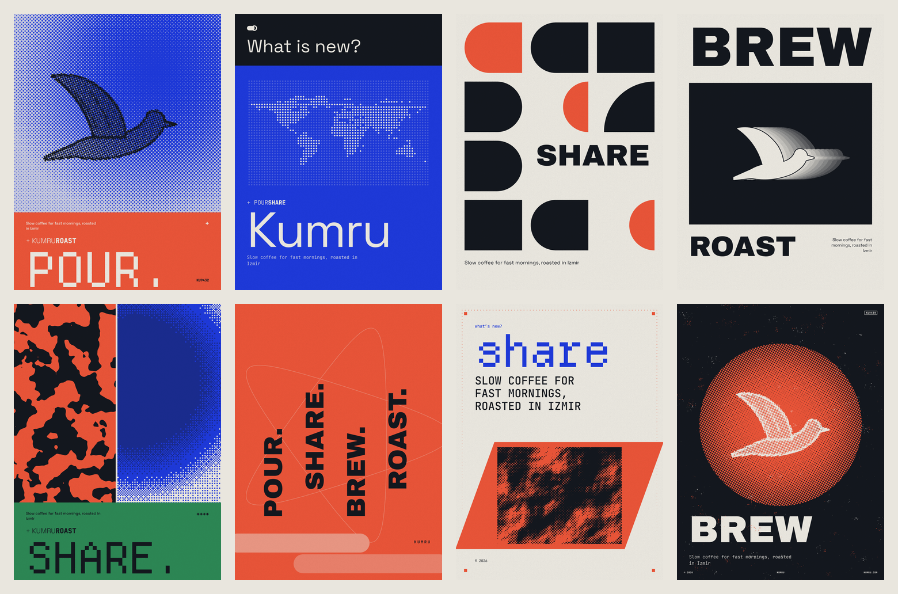
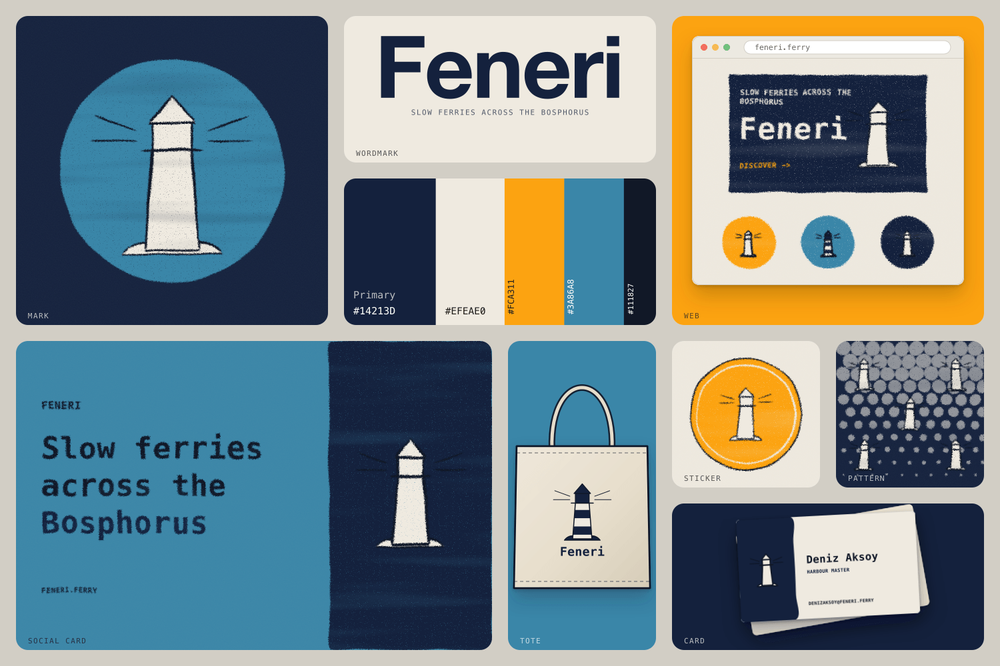

# Levni


**An open illustration library and the engine that draws it.** Levni turns a short JSON scene into a hand-inked, riso-printed image: covers, spot illustrations, icons, charts and social images in one consistent house style. No image model, no account, no API key, no cost per image. It runs on your machine, and your AI assistant can drive it through MCP.

[](https://glama.ai/mcp/servers/BoraGkc/levni) [](https://www.npmjs.com/package/@levni/levni)

**[levni.dev](https://levni.dev)** · [Features](https://levni.dev/features/) · [Library](https://levni.dev/library/) · [MCP guide](https://levni.dev/mcp/) · Powered by [Ortak Alan](https://ortakalan.io)

Named after Levni, the 18th-century Ottoman painter of the Tulip Era, whose colours still look alive.

| cover | spot | little 3D world |
| --- | --- | --- |
|  |  |  |
| [`cover.json`](examples/cover.json) | [`spot.json`](examples/spot.json) | [`room.json`](examples/room.json) |

## Quick start

**With an AI assistant (MCP).** Claude Code:

```bash
claude mcp add levni -- npx -y @levni/levni mcp
```

Claude Desktop, Cursor and other clients (`claude_desktop_config.json`, `.cursor/mcp.json`, …):

```json
{ "mcpServers": { "levni": { "command": "npx", "args": ["-y", "@levni/levni", "mcp"] } } }
```

Then ask: *"Illustrate this article with Levni and fix what the critic reports."*

**From the terminal.**

```bash
npm install @levni/levni
npx levni render scene.json out.png        # or .webp / .svg; --format og|square|story|youtube; --preview
npx levni list coffee                      # search the library
npx levni sheet props.png rocket phone     # contact sheet of props, every variant
```

**From code.**

```js
import { compose, critique, render } from '@levni/levni';

const scene = { seed: 4, elements: [{ type: 'prop', name: 'rocket', x: 600, y: 336, size: 360, shadow: true }] };
const { notes } = await render(scene, 'rocket.png');   // writes the file, returns the critic's notes
const { svg, used } = await compose(scene);            // or just the SVG
```

Node 20+. The only dependency is [sharp](https://sharp.pixelplumbing.com).

## What it draws

| | |
| --- | --- |
| **The Levni Folio** | 1,628 drawings, 3,409 variants (481 of them pixel icons), on 15 shelves, searchable in English and Turkish. CC BY 4.0. [Browse](https://levni.dev/library/) |
| **Scenes and the critic** | 73 element types on a 1200 × 673 canvas. Pressure-brush ink, riso plate misregistration, paper grain. Same seed, same picture. Every render returns layout notes: off-canvas, accidental crops, lopsided weight, no focal point. |
| **Style packs and your inks** | `riso` (default), `miniature` (Tulip Era colours, with its own tulips, carnations, cypresses and medallion), or your own colour map: every drawing follows your brand. |
| **Soft 3D finish** | `"finish": "soft"`: clean edges and film grain. A real little 3D renderer (pure JS, no GPU): glossy `ribbon3d` bands (loop, Möbius, spiral, knot), `torus3d`, `sphere3d`, `capsule3d`, `blob3d`, `cubes3d`, interlocking shapes in one `soft3d` scene, `extrude3d` that turns any Folio drawing into a 3D icon, and `soft3d` cover presets (`"preset": "auto"`, five palettes) with room for a title and an `image` badge. [Guide](docs/scene.md#soft-3d-v2-real-3d-shapes-use-with-finish-soft) |
| **Little 3D worlds** | `iso` dioramas: one line (`"preset": "cafe"`, also `room`, `desk`, `street`, `city`, `office`, `classroom`) lays out a seeded world on a floating slab with soil layers and a soft shadow. 37 object kinds (walls with windows, doors and arches, stairs, roofs, fences, ponds, roads, trees, lamps, furniture, cars, people, posters hung on walls), soft occlusion, painter's order from real 3D boxes, in the riso hand or `"style": "soft"` toy 3D. |
| **Faceless people** | `person` in 15 poses (walking, pointing, reading, phone, cheering, …), `people` in a row. Round heads, no faces, by design. |
| **Fusion slots** | Put any drawing inside another: a chart on a TV screen, a tulip in a magnifier's lens. 64 hosts have slots. |
| **Hand-inked data** | `bars`, `linechart`, `pie`, `donut`, `isochart` from plain numbers. |
| **Every format, plus a title** | cover, og, square, story, youtube: recomposed, not cropped. Optional headline, kicker and brand layer. |
| **Brand assets** | `dither` fields (Bayer squares, dots, lines, several inks) and a `screen` print pass that turns any scene into a 1-bit, riso, blueprint, Game Boy or newsprint image; grainy `meshgrad` colour fields and orbs; `glyphfill` (ASCII, block and dot-matrix silhouettes, a shaded globe); `seal`, `ringtext`, `stub` tickets and die-cut stickers; wireframe `terrain`, `ridgelines` and `engrave` etchings. Recipes at the end of [`docs/scene.md`](docs/scene.md) |
| **Branding posters** | `levni poster`: one brand spec (`{ "brand": { name, tagline, mark, inks, words } }`) becomes eight portrait posters (split, map, bauhaus, echo, camo, vertical, summit, launch) and a series sheet. Big type comes from the `type` element, which draws text as paths from bundled open fonts (Space Grotesk, Archivo Black, JetBrains Mono, Departure Mono), so it looks the same everywhere. Also `block`, `amtone`, `camo`, `grain`, `shapegrid`, `echo`, `dotmatrix` and `furniture`. [Guide](docs/poster.md) |
| **Brand boards** | `levni board`: mark, wordmark, palette, web page, social card, tote, sticker, pattern and business card in one image, from four fields (`{ "brand": { name, tagline, mark, inks } }`). [Guide](docs/board.md) |
| **Calm images for hard news** | A blue-only pack for loss, disaster, illness, courts and grief. [Guide](docs/sensitive.md) |

The `miniature` pack, the `soft` finish and soft 3D, iso dioramas, people, slots and charts:

| | | |
| --- | --- | --- |
|  |  |  |
|  |  |  |
|  |  |  |
|  |  |  |

Brand assets: dither, screen, mesh gradients, glyph fills, seals, terrain, etching and a whole brand board:

| | | |
| --- | --- | --- |
|  |  |  |
|  |  |  |

Branding posters: one spec, eight posters in one series (split, map, bauhaus, echo, camo, vertical, summit, launch):





Full element reference: [`docs/scene.md`](docs/scene.md) · JSON Schema: [`docs/scene.schema.json`](docs/scene.schema.json) · all example scenes: [`examples/`](examples/)

## Use it from an agent (MCP)

`levni mcp` runs an MCP server over stdio, on your machine. Tools:

| tool | what it does |
| --- | --- |
| `scene_guide` | the scene format ([`docs/scene.md`](docs/scene.md)); read it once |
| `list_props` | search the Folio by word, tag or shelf |
| `show_props` | a contact image of chosen props, every variant numbered |
| `render_scene` | draw a scene: critic notes, a 560 px preview, and with `out` the full file (.png/.webp/.svg) |
| `critique_scene` | only the critic's notes, for quick iterations |
| `render_board` | a brand board from `{ brand: { name, tagline, mark, inks } }` or your own tiles; `guide: true` returns [`docs/board.md`](docs/board.md) |
| `render_poster` | eight branding posters and a series sheet from `{ brand: { name, tagline, mark, inks, words } }`; `scenes: true` returns the scenes to edit, `guide: true` returns [`docs/poster.md`](docs/poster.md) |

From a checkout, use `"command": "node", "args": ["/path/to/levni/bin/levni.mjs", "mcp"]`. Files from `render_scene` are written relative to the client's working directory. Agents without MCP can use the CLI the same way.

### Ghost: images for your drafts

Add your Ghost Admin credentials to the server's `env` and three more tools appear:

```json
{ "mcpServers": { "levni": { "command": "npx", "args": ["-y", "@levni/levni", "mcp"],
  "env": { "GHOST_ADMIN_API_URL": "https://your-site.com", "GHOST_ADMIN_API_KEY": "<id>:<secret>" } } } }
```

| tool | what it does |
| --- | --- |
| `ghost_drafts` | read-only: drafts without images, their h2 headings, and one draft's full text |
| `ghost_preview` | dry run: renders the cover and inline images, shows where each goes, returns a token |
| `ghost_apply` | writes, only with the token from a preview of the same plan on the unchanged draft |

The assistant shows you the preview and applies after you say yes. Drafts only: nothing is published or emailed, a draft that already has images is skipped, at most one image per section. The key stays in your MCP config; Levni has no server of its own. Without the two variables the Ghost tools do not exist. The same flow from the terminal: `levni ghost drafts` and `levni ghost attach plan.json [--apply]`. Details: [`docs/ghost.md`](docs/ghost.md).

## CLI

| command | what it does |
| --- | --- |
| `levni render <scene.json> <out>` | draw a scene (`--format`, `--preview`) and print the critic's notes |
| `levni list [query]` | search props |
| `levni sheet <out.png> [prop …]` | contact sheet, every variant on paper and on blue (`--recolor`) |
| `levni board <spec.json> <out.png>` | brand board: `{"brand": {name, tagline, mark, inks}}` makes a nine-tile board in one call; or place tiles yourself, with browser/card/tote/phone mockups ([docs](docs/board.md)) |
| `levni poster <spec.json> <out-dir>` | branding posters: `{"brand": {name, tagline, mark, inks, words}}` makes eight 1200 × 1600 posters and `series.png` ([docs](docs/poster.md)) |
| `levni add <file> [--sheet out.png]` | import props a chat model wrote: check, write, draw ([prompt](docs/prop-prompt.md)) |
| `levni check [prop …]` | measure props for agents that cannot see images |
| `levni mcp` | the MCP server |
| `levni ghost drafts / attach` | the Ghost adapter ([docs](docs/ghost.md)) |
| `levni judge score / pick` | optional: rate renders with your own OpenRouter key ([docs](docs/judge.md)) |

Optional extras: the `icon` and `ascii` elements use [Tabler Icons](https://tabler.io/icons) when installed (`npm install @tabler/icons`, or `LEVNI_ICONS=/path`). Your own prop folders: `LEVNI_PROPS=/path/to/props` (several, separated by `:`).

## Keys and privacy

Drawing needs nothing: no account, no key. Two optional integrations bring your own key, kept in your environment or MCP config: Ghost (`GHOST_ADMIN_API_URL`, `GHOST_ADMIN_API_KEY`) and the judge (`OPENROUTER_API_KEY`). Levni sends your scenes and keys nowhere else.

## Submit to the Folio

The library grows by contribution: one JSON file per drawing in `library/props/`, SVG paths in a 0–100 box with colour names, so every style pack can recolour it.

```json
{
  "name": "watering-can",
  "category": "home",
  "tags": ["garden", "water", "sulama"],
  "author": "Your Name",
  "variants": [
    { "note": "side view, spout to the right", "paths": [
      { "d": "M20 40 L70 40 L66 86 L24 86 Z", "fill": "tone", "stroke": "ink", "weight": 9 },
      { "d": "M70 52 L92 30", "stroke": "ink", "weight": 9 }
    ] }
  ]
}
```

Rules: your own drawing (inspired by a style is fine, tracing a work is not), no faces, no hands, no logos, one object per file, readable at 120 px. Check with `npx levni add my-props.json --sheet check.png`, then open a pull request. Full guide: [CONTRIBUTING.md](CONTRIBUTING.md). Writing many at once with a chat model: [`docs/prop-prompt.md`](docs/prop-prompt.md).

## Licensing

- **Code** (`src/`, `bin/`, `adapters/`, `test/`): [MIT](LICENSE).
- **Levni Folio** (`library/`): [CC BY 4.0](library/LICENSE). Use it anywhere, commercially too; credit "drawings by Ortak Alan (CC BY 4.0)". Origins and flagged drawings: [`library/NOTICE.md`](library/NOTICE.md).
- **Tabler Icons** (MIT, Paweł Kuna): an optional peer dependency, not shipped. Props redrawn from Tabler shapes say so in their files.
- Images you render are yours; the CC BY credit applies when they contain library drawings.

## Repository

| folder | what |
| --- | --- |
| `src/` | the engine: compose, ink, pen, iso, assets, ribbons, people, charts, slots, formats, title, critic, styles, MCP |
| `bin/levni.mjs` | the CLI |
| `adapters/ghost/` | the Ghost adapter |
| `library/` | the Levni Folio and its licence |
| `docs/` | scene reference and schema, Ghost, judge, sensitive stories, the chat-model prompt |
| `examples/` | scenes and their renders |
| `site/` | [levni.dev](https://levni.dev) (Astro, static, Cloudflare Pages; images drawn by Levni: `npm run assets`, `npm run library`) |
| `test/` | `npm test` runs every test file: props, MCP, Ghost (mocked), formats, judge, critic (~2 min: it draws every variant) |

---

Levni is made and used by [Ortak Alan](https://ortakalan.io).
