<div align="center">

<a href="https://levni.dev">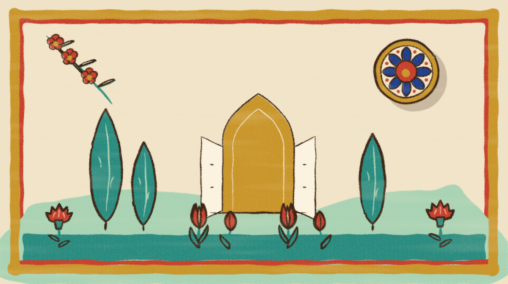</a>

<h1>Levni</h1>

**A post-AI center for designers.**<br>
Open-source design engine for AI agents: covers, icons, brand boards and posters from a short JSON scene, drawn on your machine.<br>
No image model, no API key, $0 per image; code MIT, drawings CC BY 4.0. About 0.15 s a cover, made by <a href="https://ortakalan.io">Ortak Alan</a>.

[](https://www.npmjs.com/package/@levni/levni) [](https://registry.modelcontextprotocol.io/v0/servers?search=dev.levni/levni) [](https://glama.ai/mcp/servers/BoraGkc/levni) [](LICENSE) [](https://creativecommons.org/licenses/by/4.0/)

**[levni.dev](https://levni.dev)** · [Editor](https://levni.dev/editor/) · [Gallery](https://levni.dev/gallery/) · [Library](https://levni.dev/library/) · [Docs](https://levni.dev/docs/) · [MCP](https://levni.dev/mcp/) · [Community](https://levni.dev/community/) · [Manifesto](https://levni.dev/manifesto/)

</div>

```text
        .   .   .
       /|\ /|\ /|\
      ( @@@@@@@@@ )      we are not an AI company.
       \@@@@@@@@@/       we are not against AI either.
        \@@@@@@@/        we just draw, and leave the source open.
          \@@@/
            |            claude mcp add levni -- npx -y @levni/levni mcp
       \\   |   //
        \\  |  //        try ↑ ↑ ↓ ↓ ← → ← → B A on levni.dev
    ~~~~~~~~|~~~~~~~~
```

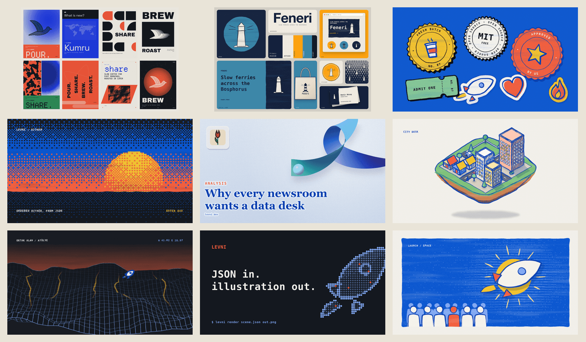

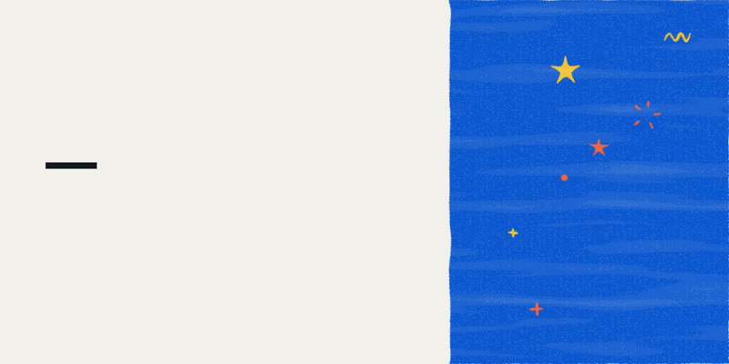

<sub>New in 0.5: any scene loops as a GIF, WebP or MP4. Every preset, with its JSON: [levni.dev/motion](https://levni.dev/motion/). This banner is 36 frames and about 0.25 MB. Make yours at [levni.dev/banner](https://levni.dev/banner/).</sub>

| make | one line to start |
| --- | --- |
| a series of eight branding posters | `npx @levni/levni poster brand.json posters/` |
| a nine-tile brand board | `npx @levni/levni board brand.json board.png` |
| a cover, sticker sheet or dithered hero | `npx @levni/levni render scene.json cover.webp` |
| a looping GIF or WebP of any scene | `npx @levni/levni animate scene.json loop.gif` |
| a whole brand kit from one name | `npx @levni/levni brand brand.json kit/` |
| fork, remix and compare designs | [levni.dev/hub](https://levni.dev/hub/) |
| a live playground for scene JSON | [levni.dev/pen](https://levni.dev/pen/) |
| a moving card of your GitHub year | [levni.dev/you](https://levni.dev/you/) |
| a moving README banner on every release | [README banner Action](docs/readme-action.md) |
| a ready-made motion shot with your words | `npx @levni/levni shot logo-sting sting.gif --title "Lale" --mark tulip` |
| riso plates for a real print run | `npx @levni/levni print scene.json print/` |
| a storyboard from a shot list | `npx @levni/levni storyboard shots.json board.png` |
| all of it from your assistant | `claude mcp add levni -- npx -y @levni/levni mcp` |
| a design by hand, no install | [levni.dev/editor](https://levni.dev/editor/) |

## Why Levni exists

Every other layer of the web went open source: the code, the fonts, the icons. The pictures did not. Making one small cover now means a credit card, an API key and a model in a good mood. Clients want it free, AI brought the fear of missing out, and every tool has a free trial.

We are living in a Tulip Era. Between 1718 and 1730 the Ottoman court fell in love with tulips and art bloomed; Levni, the painter this project is named after, painted it in colours that still look alive. Then it ended. The generative age blooms the same way. Levni is the other bet: a design commons, drawn as JSON you can read, diff and keep, made by people who still like making things.

We use AI every day. We just do not rent our taste from it. Read the [manifesto](https://levni.dev/manifesto/).

## Quick start

**Try it in your browser first.** The [Levni editor](https://levni.dev/editor/) runs the same engine in the page: drag drawings onto a canvas, turn them into 3D icons or ASCII, download PNG or SVG. The [README banner maker](https://levni.dev/banner/) turns a GitHub link into a 1280 × 640 banner. Both are free, with no sign-up.

**Free in your agent.** Levni draws on your machine, so the $20 Claude or ChatGPT plan you already have is enough: no image credits, no second bill. If Levni is useful to you, a [star on GitHub](https://github.com/Levni-Dev/levni) helps others find it. Levni has no Pro tier and nothing is locked; [four ways to keep it open](https://levni.dev/support/).

**With an AI assistant (MCP).** Claude Code:

```bash
claude mcp add levni -- npx -y @levni/levni mcp
```

Claude Desktop, Cursor and other clients (`claude_desktop_config.json`, `.cursor/mcp.json`, …):

```json
{ "mcpServers": { "levni": { "command": "npx", "args": ["-y", "@levni/levni", "mcp"] } } }
```

Codex (`~/.codex/config.toml`):

```toml
[mcp_servers.levni]
command = "npx"
args = ["-y", "@levni/levni", "mcp"]
```

Then ask: *"Illustrate this article with Levni and fix what the critic reports."*

**From the terminal.**

```bash
npm install @levni/levni
npx @levni/levni render scene.json out.png        # or .webp / .svg; --format og|square|story|youtube; --preview
npx @levni/levni list coffee                      # search the library
npx @levni/levni sheet props.png rocket phone     # contact sheet of props, every variant
```

**From code.**

```js
import { compose, critique, render } from '@levni/levni';

const scene = { seed: 4, elements: [{ type: 'prop', name: 'rocket', x: 600, y: 336, size: 360, shadow: true }] };
const { notes } = await render(scene, 'rocket.png');   // writes the file, returns the critic's notes
const { svg, used } = await compose(scene);            // or just the SVG
```

**In the browser.** The same engine runs in a page (it powers the [editor](https://levni.dev/editor/)). Load the drawings and fonts a scene uses, then compose:

```js
// vite.config.js: plugins: [levni()]   (import levni from '@levni/levni/vite')
import { compose, registerProps, registerFont, toBlob } from '@levni/levni/browser';

registerProps([await (await fetch('/props/rocket.json')).json()]);
const { svg } = await compose({ seed: 4, elements: [{ type: 'prop', name: 'rocket', x: 600, y: 336, size: 360 }] });
const png = await toBlob(svg);
```

The browser build skips what needs native code: print screens and the `icon` set.

Node 20+. Two dependencies: [sharp](https://sharp.pixelplumbing.com) (SVG to PNG and WebP) and [fontkit](https://github.com/foliojs/fontkit) (reads the bundled OFL fonts for posters and display type).

Renders are fast: a hand-inked cover takes about 0.15 s on a laptop (an M4 Mac), because Levni applies its crayon finish to the pixels itself instead of asking the SVG renderer to (about seven times faster, same picture). Batches of hundreds of images run in a minute or two, with no GPU. [How it works](https://levni.dev/blog/faster-renders/).

## Free makers in your browser

Each maker opens a finished example in the editor: change the words, the drawing and the colours, then download PNG or SVG. No install, no sign-up. When you want more, add the MCP server and ask your agent.

| make | free maker |
| --- | --- |
| stickers, seals, tickets | [levni.dev/make/stickers-seals-tickets](https://levni.dev/make/stickers-seals-tickets/) |
| a brand board | [levni.dev/make/brand-board](https://levni.dev/make/brand-board/) |
| branding posters | [levni.dev/make/branding-posters](https://levni.dev/make/branding-posters/) |
| dithered pixel art | [levni.dev/make/dither-pixel-art](https://levni.dev/make/dither-pixel-art/) |
| mesh gradients | [levni.dev/make/mesh-gradients](https://levni.dev/make/mesh-gradients/) |
| ASCII art | [levni.dev/make/ascii-art](https://levni.dev/make/ascii-art/) |
| wireframe terrain and etching | [levni.dev/make/wireframe-terrain-etching](https://levni.dev/make/wireframe-terrain-etching/) |
| 3D icons | [levni.dev/make/3d-icons](https://levni.dev/make/3d-icons/) |
| pixel icons | [levni.dev/make/pixel-icons](https://levni.dev/make/pixel-icons/) |
| a README banner, still or moving | [levni.dev/banner](https://levni.dev/banner/) |
| grainy mesh gradients | [levni.dev/tools/mesh-gradient-generator](https://levni.dev/tools/mesh-gradient-generator/) |
| SVG patterns in your brand colours | [levni.dev/tools/svg-pattern-generator](https://levni.dev/tools/svg-pattern-generator/) |
| blobs, waves and section dividers | [levni.dev/tools/blob-wave-generator](https://levni.dev/tools/blob-wave-generator/) |
| Open Graph images, no watermark | [levni.dev/tools/og-image-generator](https://levni.dev/tools/og-image-generator/) |
| isometric worlds | [levni.dev/make/isometric-illustrations](https://levni.dev/make/isometric-illustrations/) |
| hand-drawn charts | [levni.dev/make/hand-drawn-charts](https://levni.dev/make/hand-drawn-charts/) |
| blog covers and Open Graph images | [levni.dev/make/blog-covers-og-images](https://levni.dev/make/blog-covers-og-images/) |
| a README banner from a repo link | [levni.dev/banner](https://levni.dev/banner/) |

## What it draws

| | |
| --- | --- |
| **The Levni Folio** | 1,628 drawings, 3,409 variants (481 of them pixel icons), on 15 shelves, searchable in English and Turkish through ~11,800 tags. Each drawing has its own page (`levni.dev/library/<name>/`) with every variant as SVG, the drawing in every style, copy-ready code, its search words and related drawings; the whole grid can be drawn as ink, 3D, ASCII, dots or dot lines in one click. Renamed drawings keep their old names. No brand logos. CC BY 4.0. [Browse](https://levni.dev/library/) · [In use](https://levni.dev/library/in-use/) |
| **Scenes and the critic** | 74 element types on a 1200 × 673 canvas. Pressure-brush ink, riso plate misregistration, paper grain. Same seed, same picture. Every render returns layout notes: off-canvas, accidental crops, lopsided weight, no focal point. |
| **Animation** | Any scene as a looping GIF, animated WebP or MP4. `t` runs 0..1: clouds drift, flags wave, mesh gradients breathe, ASCII globes and soft 3D turn. Any element takes `motion` (float, sway, pulse, spin, pop, fade, slide, wipe, typewriter) and the scene a `camera`. README banners type themselves. Same seed, same frames; no browser, and GIFs come from Levni's own encoder at about half the usual size. Also frame sequences, sprite sheets, transparent PNGs and seamless tiles. [docs/animate.md](docs/animate.md), [docs/export.md](docs/export.md) |
| **Brand kits** | One brand (a name, or a website to read name and colours from) becomes a folder: mark, favicons, palette, link preview, cover, square, story, README banner, brand board, posters and a loop, in the same inks, with an `index.html` to look at them. [docs/brandkit.md](docs/brandkit.md) |
| **Storyboards** | A shot list becomes a numbered sheet with titles, durations, timecodes and notes, plus full-size frames and `shots.json` for a video tool. [docs/storyboard.md](docs/storyboard.md) |
| **Style packs and your inks** | `riso` (default), `miniature` (Tulip Era colours, with its own tulips, carnations, cypresses and medallion), or your own colour map: every drawing follows your brand. |
| **Soft 3D finish** | `"finish": "soft"`: clean edges and film grain. A real little 3D renderer (pure JS, no GPU): glossy `ribbon3d` bands (loop, Möbius, spiral, knot), `torus3d`, `sphere3d`, `capsule3d`, `blob3d`, `cubes3d`, interlocking shapes in one `soft3d` scene, `extrude3d` that turns any Folio drawing into a 3D icon, and `soft3d` cover presets (`"preset": "auto"`, five palettes) with room for a title and an `image` badge. [Guide](docs/scene.md#soft-3d-v2-real-3d-shapes-use-with-finish-soft) |
| **Little 3D worlds** | `iso` dioramas: one line (`"preset": "cafe"`, also `room`, `desk`, `street`, `city`, `office`, `classroom`) lays out a seeded world on a floating slab with soil layers and a soft shadow. 37 object kinds (walls with windows, doors and arches, stairs, roofs, fences, ponds, roads, trees, lamps, furniture, cars, people, posters hung on walls), soft occlusion, painter's order from real 3D boxes, in the riso hand or `"style": "soft"` toy 3D. |
| **Faceless people** | `person` in 15 poses (walking, pointing, reading, phone, cheering, …), `people` in a row. Round heads, no faces, by design. |
| **Fusion slots** | Put any drawing inside another: a chart on a TV screen, a tulip in a magnifier's lens. 64 hosts have slots. |
| **Hand-inked data** | `bars`, `linechart`, `pie`, `donut`, `isochart` from plain numbers. |
| **Every format, plus a title** | cover, og, square, story, youtube: recomposed, not cropped. Optional headline, kicker and brand layer. |
| **Brand assets** | `dither` fields (Bayer squares, dots, lines, several inks) and a `screen` print pass that turns any scene into a 1-bit, riso, blueprint, Game Boy or newsprint image; grainy `meshgrad` colour fields and orbs; `glyphfill` (ASCII, block and dot-matrix silhouettes, a shaded globe); `seal`, `ringtext`, `stub` tickets and die-cut stickers; wireframe `terrain`, `ridgelines` and `engrave` etchings; `dotline` (any drawing or iso scene redrawn as a dot matrix, hidden edges in grey, a shimmer that loops) and a `lens` pass (a liquid-glass search bar that magnifies and bends the picture under it). Recipes at the end of [`docs/scene.md`](docs/scene.md) |
| **Branding posters** | `levni poster`: one brand spec (`{ "brand": { name, tagline, mark, inks, words } }`) becomes eight portrait posters (split, map, bauhaus, echo, camo, vertical, summit, launch) and a series sheet. Big type comes from the `type` element, which draws text as paths from bundled open fonts (Space Grotesk, Archivo Black, JetBrains Mono, Departure Mono), so it looks the same everywhere. Also `block`, `amtone`, `camo`, `grain`, `shapegrid`, `echo`, `dotmatrix` and `furniture`. [Guide](docs/poster.md) |
| **Brand boards** | `levni board`: mark, wordmark, palette, web page, social card, tote, sticker, pattern and business card in one image, from four fields (`{ "brand": { name, tagline, mark, inks } }`). [Guide](docs/board.md) |
| **Calm images for hard news** | A blue-only pack for loss, disaster, illness, courts and grief. [Guide](docs/sensitive.md) |

The `miniature` pack, the `soft` finish and soft 3D, iso dioramas, people, slots and charts:

| | | |
| --- | --- | --- |
|  | 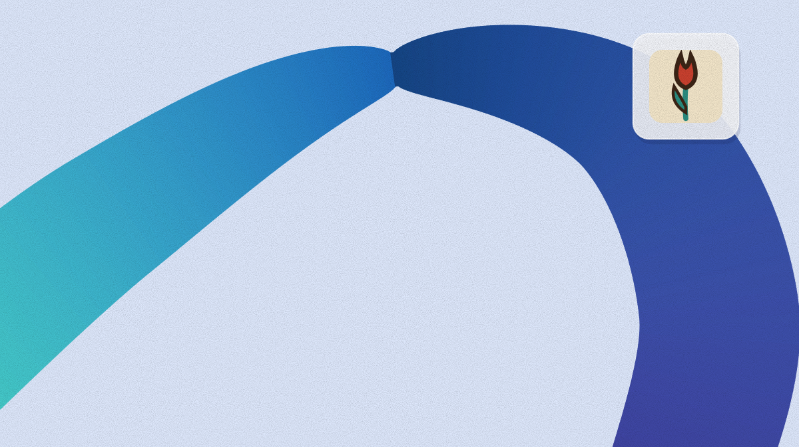 |  |
| 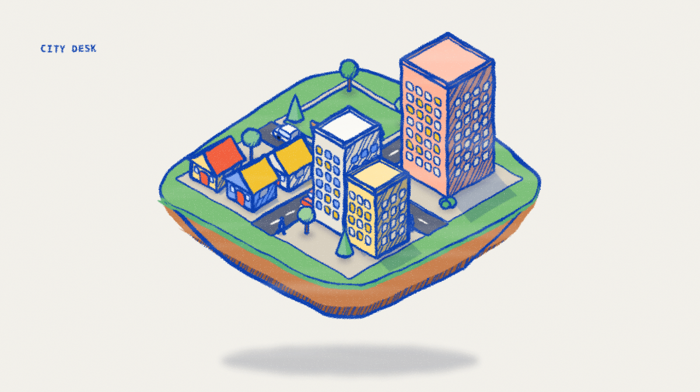 | 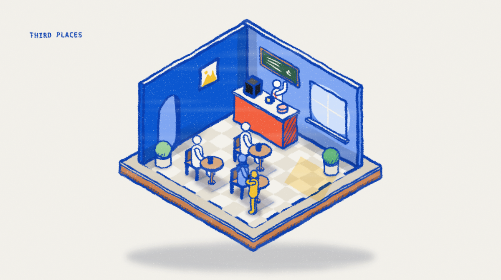 |  |
|  | 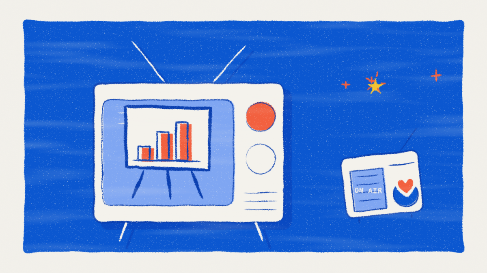 | 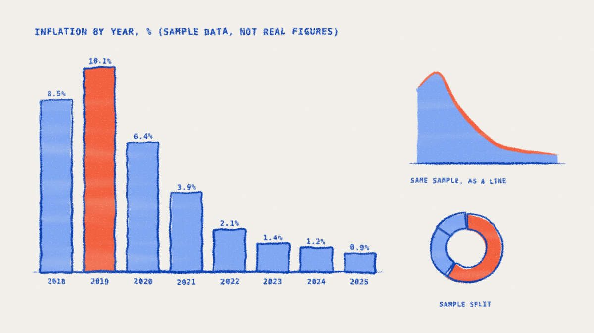 |
|  | 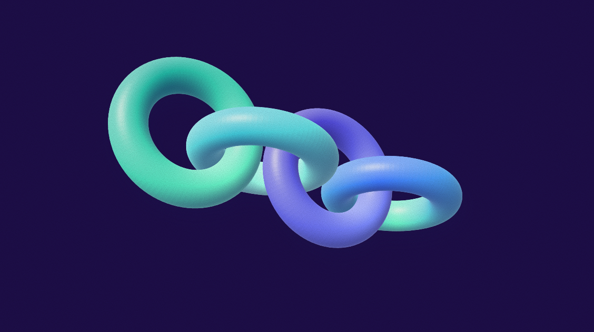 |  |

Brand assets: dither, screen, mesh gradients, glyph fills, dot lines and glass, seals, terrain, etching and a whole brand board:

| | | |
| --- | --- | --- |
| 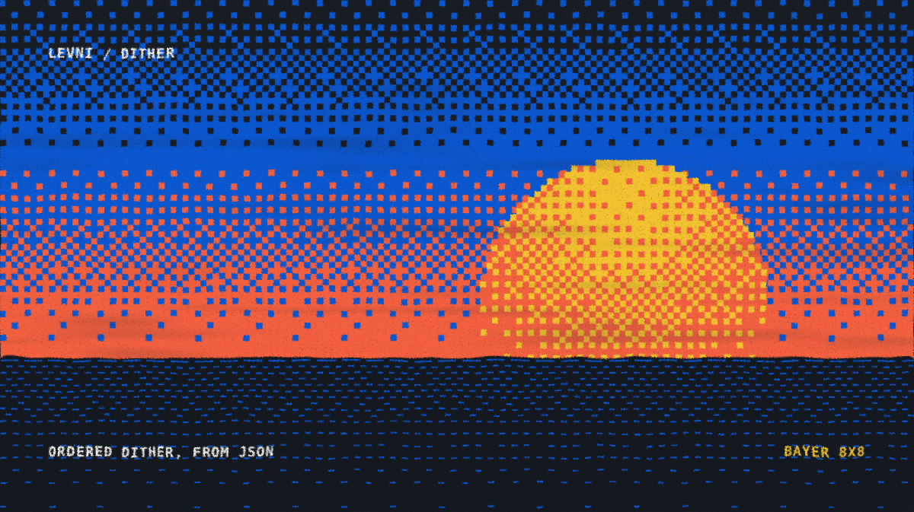 |  |  |
|  | 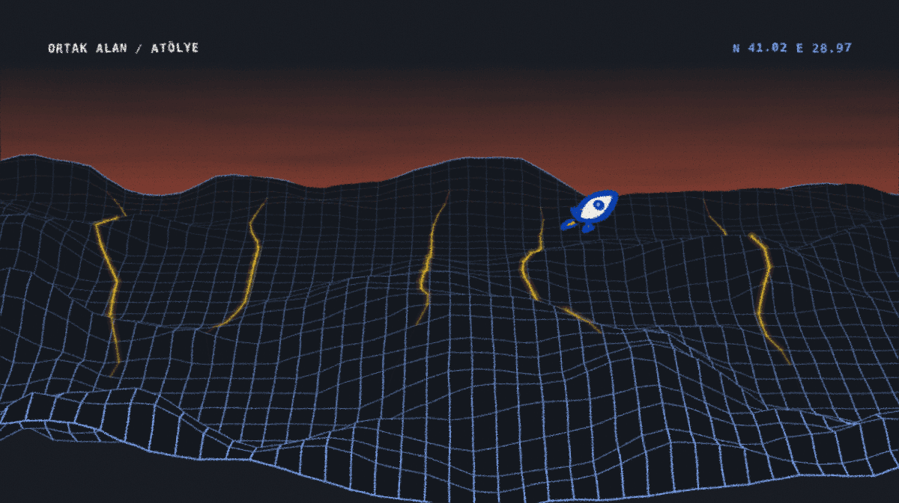 |  |
| 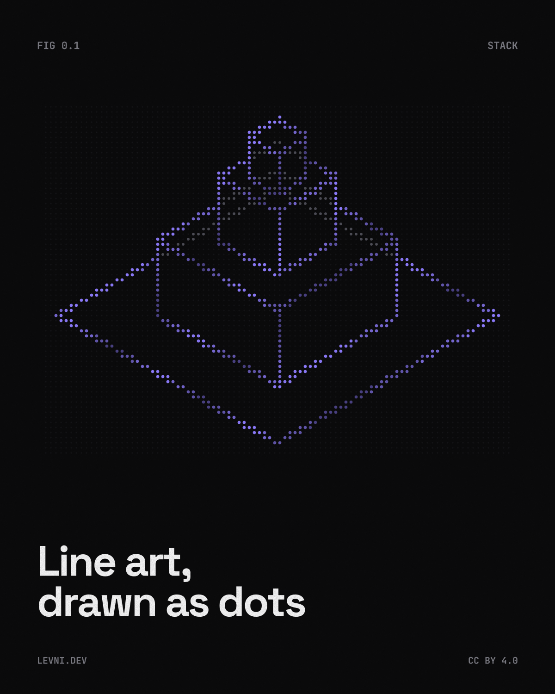 | 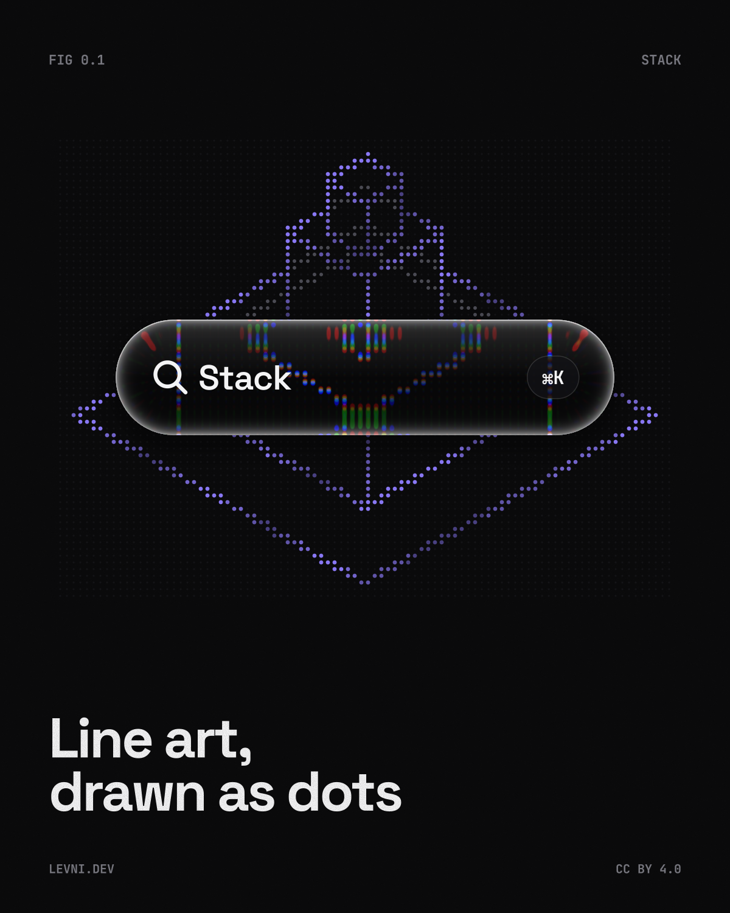 | |

Branding posters: one spec, eight posters in one series (split, map, bauhaus, echo, camo, vertical, summit, launch):


Full element reference: [`docs/scene.md`](docs/scene.md) · JSON Schema: [`docs/scene.schema.json`](docs/scene.schema.json) · all example scenes: [`examples/`](examples/)

## Use it from an agent (MCP)

`levni mcp` runs an MCP server over stdio, on your machine. Tools:

| tool | what it does |
| --- | --- |
| `scene_guide` | the scene format ([`docs/scene.md`](docs/scene.md)); read it once |
| `list_props` | search the Folio by word, tag or shelf |
| `show_props` | a contact image of chosen props, every variant numbered |
| `render_scene` | draw a scene: critic notes, a 560 px preview, and with `out` the full file (.png/.webp/.svg) |
| `critique_scene` | only the critic's notes, for quick iterations |
| `render_animation` | draw a scene as a loop and write a .gif or .webp: critic notes and a strip of four frames ([docs](docs/animate.md)) |
| `render_brand_kit` | a whole brand kit into a folder; reads a website only when you pass `url` ([docs](docs/brandkit.md)) |
| `render_reel` | shots or scenes joined with transitions into one video ([docs](docs/reel.md)) |
| `render_shot` | a ready-made motion shot with your words, drawing and inks; lists the shots when called with no name ([docs](docs/shots.md)) |
| `render_print` | a scene as riso plates for a real print run, with a proof and a sheet ([docs](docs/print.md)) |
| `render_storyboard` | a shot list as a numbered storyboard sheet, with optional full-size frames and `shots.json` ([docs](docs/storyboard.md)) |
| `render_board` | a brand board from `{ brand: { name, tagline, mark, inks } }` or your own tiles; `guide: true` returns [`docs/board.md`](docs/board.md) |
| `render_poster` | eight branding posters and a series sheet from `{ brand: { name, tagline, mark, inks, words } }`; `scenes: true` returns the scenes to edit, `guide: true` returns [`docs/poster.md`](docs/poster.md) |

From a checkout, use `"command": "node", "args": ["/path/to/levni/bin/levni.mjs", "mcp"]`. Files from `render_scene` are written relative to the client's working directory. Agents without MCP can use the CLI the same way.

### Ghost: images for your drafts

Add your Ghost Admin credentials to the server's `env` and three more tools appear:

```json
{ "mcpServers": { "levni": { "command": "npx", "args": ["-y", "@levni/levni", "mcp"],
  "env": { "GHOST_ADMIN_API_URL": "https://your-site.com", "GHOST_ADMIN_API_KEY": "<id>:<secret>" } } } }
```

| tool | what it does |
| --- | --- |
| `ghost_drafts` | read-only: drafts without images, their h2 headings, and one draft's full text |
| `ghost_preview` | dry run: renders the cover and inline images, shows where each goes, returns a token |
| `ghost_apply` | writes, only with the token from a preview of the same plan on the unchanged draft |

The assistant shows you the preview and applies after you say yes. Drafts only: nothing is published or emailed, a draft that already has images is skipped, at most one image per section. The key stays in your MCP config; Levni has no server of its own. Without the two variables the Ghost tools do not exist. The same flow from the terminal: `levni ghost drafts` and `levni ghost attach plan.json [--apply]`. Details: [`docs/ghost.md`](docs/ghost.md).

## CLI

| command | what it does |
| --- | --- |
| `levni render <scene.json> <out>` | draw a scene (`--format`, `--preview`) and print the critic's notes |
| `levni animate <scene.json> <out.gif\|out.webp\|out.mp4>` | draw a scene as a loop: clouds drift, flags wave, gradients breathe, 3D spins, and any element with `motion` moves (`--frames`, `--fps`, `--boil`, `--width`, `--strip`, `--frames-dir`, `--sprite`) ([docs](docs/animate.md), [export](docs/export.md)) |
| `levni brand <brand.json\|url> <out-dir>` | a whole brand kit in one folder (`--posters 8`, `--only a,b`) ([docs](docs/brandkit.md)) |
| `levni reel <reel.json> <out.mp4>` | shots or scenes joined with transitions ([docs](docs/reel.md)) |
| `levni desk [dir]` | a local panel: every scene in the folder drawn, watched and exported ([docs](docs/desk.md)) |
| `levni banner <out.gif> --repo owner/name` | a README banner for a GitHub repo; also [a GitHub Action](docs/readme-action.md) |
| `levni open` / `levni remix <image.png>` | every Levni PNG carries its scene: get it back, add your name to its remix chain ([docs](docs/stamp.md)) |
| `levni shot <name> <out>` | 25 ready-made motion shots with your `--title`, `--mark`, `--inks` and `--format`; `levni shot --list` ([docs](docs/shots.md)) |
| `levni print <scene.json> <out-dir>` | riso plates: one grayscale image per ink, a proof, a sheet and `print.json` (`--scale`, `--plates`, `--halftone`) ([docs](docs/print.md)) |
| `levni storyboard <spec.json> <out.png>` | storyboard sheet from a shot list (`--frames-dir`, `--columns`) ([docs](docs/storyboard.md)) |
| `levni list [query]` | search props by name, old name or tag (English or Turkish) |
| `levni sheet <out.png> [prop …]` | contact sheet, every variant on paper and on blue (`--recolor`) |
| `levni board <spec.json> <out.png>` | brand board: `{"brand": {name, tagline, mark, inks}}` makes a nine-tile board in one call; or place tiles yourself, with browser/card/tote/phone mockups ([docs](docs/board.md)) |
| `levni poster <spec.json> <out-dir>` | branding posters: `{"brand": {name, tagline, mark, inks, words}}` makes eight 1200 × 1600 posters and `series.png` ([docs](docs/poster.md)) |
| `levni add <file> [--sheet out.png]` | import props a chat model wrote: check, write, draw, print style notes ([prompt](docs/prop-prompt.md), [guide](docs/folio-guide.md)) |
| `levni check [prop …]` | measure props for agents that cannot see images; with names, also style notes |
| `levni mcp` | the MCP server |
| `levni ghost drafts / attach` | the Ghost adapter ([docs](docs/ghost.md)) |
| `levni judge score / pick` | optional: rate renders with your own OpenRouter key ([docs](docs/judge.md)) |

Optional extras: the `icon` and `ascii` elements use [Tabler Icons](https://tabler.io/icons) when installed (`npm install @tabler/icons`, or `LEVNI_ICONS=/path`). Your own prop folders: `LEVNI_PROPS=/path/to/props` (several, separated by `:`).


`LEVNI_RASTER=rsvg` switches back to the SVG renderer's own filter (slower; useful to compare). In code: `import { rasterize } from '@levni/levni'` turns any Levni SVG into a PNG (or raw pixels with `{ raw: true }`, at any `density`).

## Keys and privacy

Drawing needs nothing: no account, no key. Two optional integrations bring your own key, kept in your environment or MCP config: Ghost (`GHOST_ADMIN_API_URL`, `GHOST_ADMIN_API_KEY`) and the judge (`OPENROUTER_API_KEY`). Levni sends your scenes and keys nowhere else.

## Skills for your agent

[Levni Skills](https://github.com/Levni-Dev/levni-skills) teach an agent how to art-direct what it draws: `levni-taste` (when to draw, one style per brand, safe areas, the render and critic loop) and `levni-motion` (loops and where each format plays), with sixteen recipe cards.

```bash
npx skills add Levni-Dev/levni-skills
```

## Community: open design, together

Levni is a commons, and there are five ways in. All of them are open: [levni.dev/community](https://levni.dev/community/).

| door | how |
| --- | --- |
| **Draw for the Folio** | one JSON file per drawing in `library/props/`, check it with `npx @levni/levni add my-drawing.json --sheet check.png`, open a pull request. Your name goes in the file and the credits. |
| **Ask for a drawing** | [prop request](https://github.com/Levni-Dev/levni/issues/new?template=prop-request.yml): say what scene needs it |
| **Share a style pack** | [style pack](https://github.com/Levni-Dev/levni/issues/new?template=style-pack.yml): the whole library in your palette |
| **Bring your brand, show your work** | [showcase](https://github.com/Levni-Dev/levni/issues/new?template=showcase.yml): a brand.json, a README banner, a poster series, with the scene |
| **Talk** | [issues](https://github.com/Levni-Dev/levni/issues), and the [Code of Conduct](CODE_OF_CONDUCT.md) for everyone |

A drawing looks like this:

```json
{
  "name": "watering-can",
  "category": "home",
  "tags": ["garden", "water", "sulama"],
  "author": "Your Name",
  "variants": [
    { "note": "side view, spout to the right", "paths": [
      { "d": "M20 40 L70 40 L66 86 L24 86 Z", "fill": "tone", "stroke": "ink", "weight": 9 },
      { "d": "M70 52 L92 30", "stroke": "ink", "weight": 9 }
    ] }
  ]
}
```

Rules: your own drawing (inspired by a style is fine, tracing a work is not), no faces, no hands, no logos, one object per file, readable at 120 px. Full guide: [CONTRIBUTING.md](CONTRIBUTING.md), naming and tagging: [`docs/folio-guide.md`](docs/folio-guide.md), file schema: [`docs/prop.schema.json`](docs/prop.schema.json), why no logos: [BRAND_LOGOS.md](BRAND_LOGOS.md). Writing many at once with a chat model: [`docs/prop-prompt.md`](docs/prop-prompt.md).

**Wanted for the Folio crew:** illustrators, type nerds, riso printers, icon pedants, agent tinkerers, prompt sceptics, OSS maintainers, brand people, miniature fans, people who still sketch. Reward: your name in every scene that uses your work.

## No FOMO lists

We also curate other people's open work, under one rule: open licence, free to start, maintained. Levni appears once in each, as an ordinary entry.

| list | what |
| --- | --- |
| [Awesome Open Design](https://github.com/Levni-Dev/awesome-open-design) | 100+ open design tools, icon sets, illustrations, fonts, colour and creative code |
| [Awesome Design MCP](https://github.com/Levni-Dev/awesome-design-mcp) | 55 open-source MCP servers that let AI agents do design work |
| [Awesome Lettering](https://github.com/Levni-Dev/awesome-lettering) | 86 open type tools, fonts, lettering and kinetic type resources |

Browse them on [levni.dev/lists](https://levni.dev/lists/).

## Licensing

- **Code** (`src/`, `bin/`, `adapters/`, `test/`): [MIT](LICENSE).
- **Levni Folio** (`library/`): [CC BY 4.0](library/LICENSE). Use it anywhere, commercially too; credit "drawings by Ortak Alan (CC BY 4.0)". Origins and flagged drawings: [`library/NOTICE.md`](library/NOTICE.md).
- **Tabler Icons** (MIT, Paweł Kuna): an optional peer dependency, not shipped. Props redrawn from Tabler shapes say so in their files.
- Images you render are yours; the CC BY credit applies when they contain library drawings.

## Repository

| folder | what |
| --- | --- |
| `src/` | the engine: compose, ink, pen, iso, assets, ribbons, people, charts, slots, formats, title, critic, styles, MCP |
| `src/browser.mjs`, `src/browser/` | the browser build (shims for `node:fs`, `sharp` and friends, a Vite plugin); `src/banner.mjs` builds README banners |
| `bin/levni.mjs` | the CLI |
| `adapters/ghost/` | the Ghost adapter |
| `library/` | the Levni Folio and its licence |
| `docs/` | scene reference and schema, prop schema, Ghost, judge, sensitive stories, the chat-model prompt |
| `examples/` | scenes and their renders |
| `site/` | [levni.dev](https://levni.dev) (Astro, static, Cloudflare Pages; images drawn by Levni: `npm run assets`, `npm run library`). The editor is `site/src/components/Editor.astro`; the free makers are `site/src/data/make.ts` (one entry per `/make/` page) and `site/src/data/make-links.ts` (which feature, gallery group, post and docs page leads to which maker) |
| `test/` | `npm test` runs every test file: props, MCP, Ghost (mocked), formats, judge, critic (~2 min: it draws every variant) |

---

<div align="center">

Made and used by [Ortak Alan](https://ortakalan.io), the same crew as [cartcurt.xyz](https://cartcurt.xyz).<br>
Inspired by our friend Berk Boz and [Zero Bytes Foundation](https://medium.com/zero-bytes-foundation/what-if-we-imagined-a-studio-669f954a05f7): consume, curate, cogitate, create.<br>
Named after Levni, court painter of the Tulip Era (d. 1732).

<sub>No image model was harmed in the making of this README.</sub>

</div>
