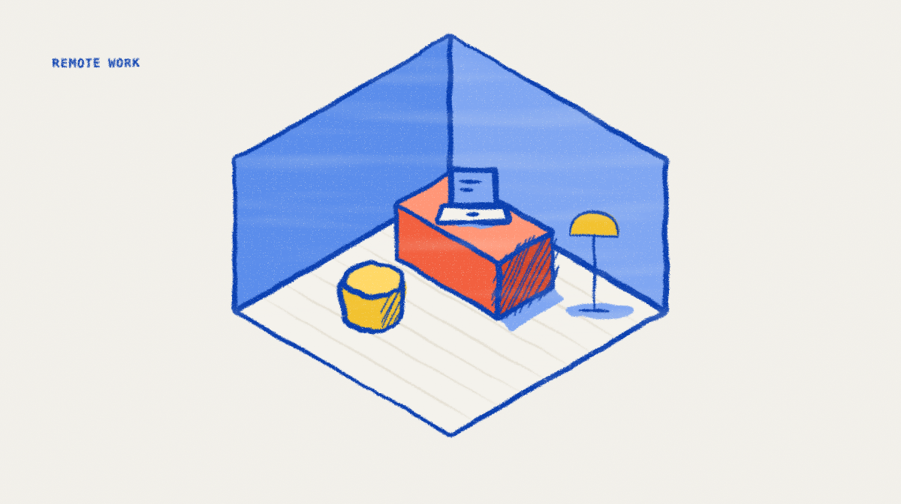
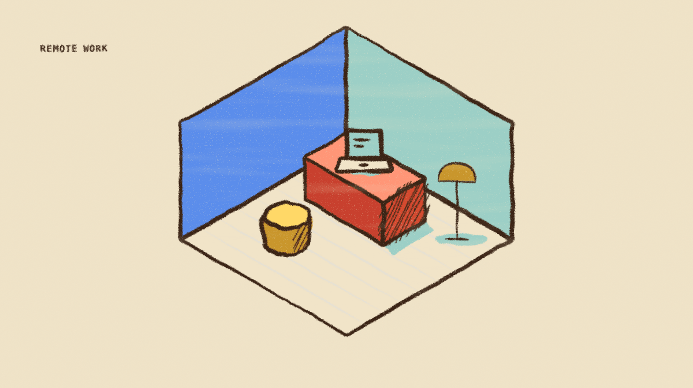
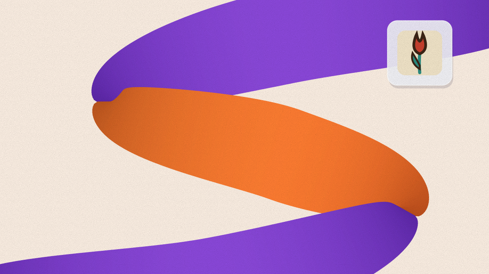
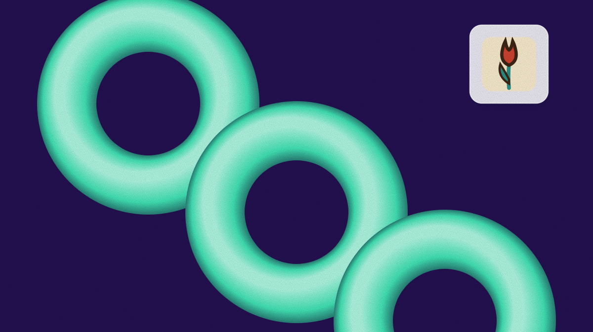

# Levni


**Hand-inked, riso-printed illustrations from a JSON scene.** Design assets for agents and publishers: covers, spot illustrations, icons and social images, drawn by code in one consistent house style, with no image model, no API key and no per-image cost.

Website: **[levni.dev](https://levni.dev)** · Powered by [Ortak Alan](https://ortakalan.io). Named after Levni, the 18th-century Ottoman miniaturist of the Tulip Era, whose colours were famously alive.

| cover | spot | little 3D world |
| --- | --- | --- |
|  |  |  |
| [`cover.json`](examples/cover.json) | [`spot.json`](examples/spot.json) | [`room.json`](examples/room.json) |

The same room in the `miniature` style pack:



The `soft` finish:

| | | |
| --- | --- | --- |
|  |  |  |

## Why

- **Agents can draw.** A scene is plain JSON: an agent (or a person) places props, panels and textures; Levni does the hand. Same seed, same picture.
- **One look across hundreds of images.** Ortak Alan made ~500 article images with it: pressure-brush ink, riso plate misregistration, crayon paper grain.
- **A shared library: the Levni Folio.** 474 drawn props (708 variants), CC BY 4.0, open to contributions.
- **A critic built in.** Every render returns layout notes (off-canvas, accidental crops, lopsided weight, no focal point) an agent can act on before a human looks.
- **Style packs.** The same scene printed with other inks and paper: `riso` (Ortak Alan's house look, default) and `miniature`, inspired by Tulip Era Ottoman painting, with its own tulips, carnations, cypresses and gilded medallion. Levni does not have to invent every look itself: it can take a tradition as its reference and then draw in it consistently. Set `"style": "miniature"` on a scene; a pack is a colour map in `src/styles.mjs`.
- **A soft 3D finish.** `"finish": "soft"` swaps the crayon for clean edges and film grain, with twisting gradient `ribbon`s, shaded `tube`s and an `image` badge for a logo you own. Good for tech and guide covers. Examples: [`ribbon-loop`](examples/ribbon-loop.json), [`ribbon-s`](examples/ribbon-s.json), [`ribbon-rings`](examples/ribbon-rings.json).
- **Data charts.** `bars`, `linechart`, `pie`, `donut` and `isochart` take plain numbers and draw them with the same wobbly ink, flat riso fills and plate misregistration as everything else; values print only with `showValues`. Example: [`chart-inflation`](examples/chart-inflation.json) (sample data).
- **MCP-ready.** The API is three calls (`compose`, `critique`, `render`) over JSON in, image out, so it maps directly onto MCP tools. An MCP server is planned.

## Install and use

```bash
npm install levni
```

```bash
npx levni render scene.json out.png        # or out.webp / out.svg; --preview also writes a 560 px JPEG
npx levni sheet props.png rocket phone     # contact sheet of props (all variants, on paper and on blue)
npx levni list coffee                      # find props by name or tag
npx levni add batch.txt --sheet batch.png  # import props a chat model wrote, check them, draw them
```

```js
import { compose, critique, render } from 'levni';

const scene = { seed: 4, elements: [{ type: 'prop', name: 'rocket', x: 600, y: 336, size: 360, shadow: true }] };
const { notes } = await render(scene, 'rocket.png');   // writes the file, returns the critic's notes
const { svg, used } = await compose(scene);            // or just the SVG string
```

Requires Node 20+. The only dependency is [sharp](https://sharp.pixelplumbing.com) for rasterizing. The `icon` and `ascii` elements use [Tabler Icons](https://tabler.io/icons) (MIT, ~5,500 icons) when installed: `npm install @tabler/icons`, or point `LEVNI_ICONS` at a folder holding `outline/` and `filled/`.

Your own prop folders: set `LEVNI_PROPS=/path/to/props` (several, separated by `:`), or call `addPropDir()`.

## Scene format

```json
{ "seed": 5, "clip": [60, 52, 1080, 569], "elements": [
  { "type": "panel", "x": 60, "y": 52, "w": 1080, "h": 569, "color": "blue" },
  { "type": "prop", "name": "rocket", "x": 780, "y": 300, "size": 380, "rot": 20 },
  { "type": "crowd", "x": 90, "y": 560, "w": 520, "rows": 2, "size": 130, "highlight": "coral" }
] }
```

Canvas 1200 × 673. 39 element types: library props and your own path drawings (with extrusion, hatch shading and cast shadows), small isometric worlds, panels, glyph fields, halftones, flow fields, faceless crowds and isotype grids, bubbles, trees, flags, arrows, labels. Full reference: [`docs/scene.md`](docs/scene.md); JSON Schema: [`docs/scene.schema.json`](docs/scene.schema.json).

## Licensing

- **Code** (`src/`, `bin/`, `test/`): [MIT](LICENSE).
- **Levni Folio**, the prop library (`library/`): [CC BY 4.0](library/LICENSE). Use it anywhere, commercially too; credit "drawings by Ortak Alan (CC BY 4.0)". Where the drawings come from and which ones are flagged: [`library/NOTICE.md`](library/NOTICE.md).
- **Tabler Icons** are MIT (Paweł Kuna), an optional peer dependency, not shipped in this package.
- Images you render are yours; the CC BY credit applies when they contain library props.

## Submit to the Folio

Short version below; the full guide is [CONTRIBUTING.md](CONTRIBUTING.md).

The Levni Folio grows by contribution. A prop is one JSON file in `library/props/` (to write many at once with any chat model, see [`docs/prop-prompt.md`](docs/prop-prompt.md) and `levni add`):

```json
{
  "name": "watering-can",
  "tags": ["garden", "water", "sulama"],
  "author": "Your Name",
  "variants": [
    { "note": "side view, spout to the right", "paths": [
      { "d": "M20 40 L70 40 L66 86 L24 86 Z", "fill": "tone", "stroke": "ink", "weight": 9 },
      { "d": "M70 52 L92 30", "stroke": "ink", "weight": 9 },
      { "d": "M30 40 Q45 18 60 40", "stroke": "ink", "weight": 8 }
    ] }
  ]
}
```

- **Format.** `name` is the file name: lowercase `a-z0-9` and hyphens, English. `tags` in any language. Draw in a 0–100 box, roughly centred, the object filling 70–90 of it. Paths use colour **names** (`ink`, `blue`, `tone`, `coral`, `mustard`, `green`, `paper`, `white`), not hex, so palettes can be swapped. `weight` is the line width in output pixels (6–10 reads well). A second angle or state of the same object is another variant, not another prop.
- **Inspired by, not copied from.** Drawing in the spirit of a style or tradition (a miniature tulip, a riso poster) is welcome; tracing a specific work is not.
- **Check it.** `npx levni sheet check.png watering-can` shows every variant on paper and on blue; `npm test` validates and renders the whole Folio.
- **Review rules.**
  - **Own work only.** Drawn by you, not traced from photos, icon sets, stock or other illustrations. AI-assisted path code is accepted when you directed and checked it; say so in the pull request.
  - **No faces.** No human faces, portraits or hands; people only as faceless pictograms.
  - **No logos or trademarks**, and nothing that reads as one (a bitten apple, a swoosh, a real flag by accident).
  - **One object, one idea.** No text inside drawings, no scenes (compose those in a scene file).
  - **House style.** Simple shapes, two inks plus paper, readable at 120 px.
- **License.** By submitting to the Folio you release the drawing under CC BY 4.0 and are credited in its `author` field.

## Website

`site/` is the levni.dev site (Astro, static, Cloudflare Pages). Its images are drawn by Levni: `npm run assets` in `site/` re-renders them, `npm run build` builds `site/dist`.

## Tests

```bash
npm test   # validates every prop file, composes each variant alone, rasterizes all 708 variants once (~30 s)
```

---

Levni is made and used by [Ortak Alan](https://ortakalan.io).
