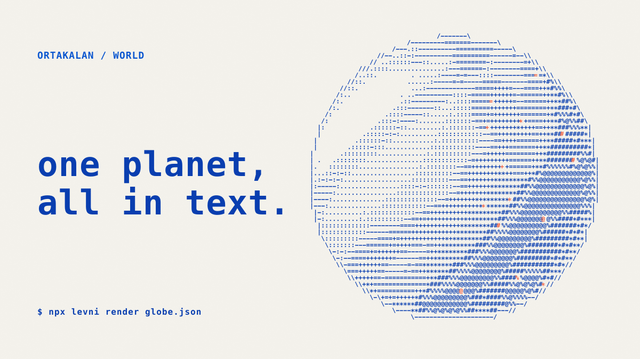

# Animation

Levni draws a scene as a short loop. The scene format already carries time: `t` runs from 0 to 1, and the elements
that know how to move follow it. `animate` draws the scene at N moments of `t` and joins the frames into an animated
GIF or WebP. No browser, no video tool, no new dependency.



```bash
npx @levni/levni animate scene.json loop.gif --width 800
npx @levni/levni animate scene.json loop.webp --frames 36 --fps 12 --boil 3 --strip frames.png
```

```js
import { animate } from '@levni/levni';
const { notes, bytes } = await animate(scene, 'loop.gif', { frames: 24, fps: 12, width: 800 });
```

From an agent: the MCP tool `render_animation` takes the same scene and options, writes the file and returns the
critic's notes with a strip of four frames to look at.

## Options

| option | default | meaning |
| --- | --- | --- |
| `frames` | `24` | frames in the loop (1..240); frame `i` is drawn at `t = i / frames` |
| `fps` | `12` | frames per second (GIF stores delays in 1/100 s, so 12 becomes 12.5) |
| `boil` | `0` | hand-drawn shimmer: this many crayon textures (2..8) take turns, about six changes a second. `0` keeps the paper steady |
| `width` | canvas width | output width in px; 800 suits a README |
| `loop` | `0` | repeat count, `0` = forever |
| `colours` | `64` | GIF palette size (2..256); more colours for gradients, fewer for line art |
| `quality` | `80` | WebP quality |

`--format og|square|story|youtube` works as in `render`. `--strip out.png` writes a few frames side by side.

## What moves

| element | motion over one loop |
| --- | --- |
| `cloud` with `drift` (px) | slides `drift` px to one side, back, and the same to the other |
| `tree`, `plant` | sway |
| `flag` | one wave travels along it |
| `confetti` | one full fall (`kind`: confetti, rain, stars) |
| `sunburst` | rays turn two steps |
| `rose` | turns one petal |
| `flowfield`, `halftone`, `dither` | the field shifts in a small circle |
| `meshgrad` | each blob moves on its own small circle (`drift`, default 0.06) |
| `glyphfill` (sphere, globe) | turns once |
| `soft3d`, `extrude` with `spin` | `spin` turns per loop |
| `ribbon` | the twist travels along the ribbon |
| `spiro` with `animate: true` | draws itself on (a reveal, not a loop) |

Props, panels, type and charts stand still; `iso` scenes move through the trees and clouds they hold. When no frame differs from the first, the notes say so; add one of the
elements above, or set `boil` to make a still drawing shimmer.

## Rules

1. **Same scene, same seed, same `t`: same frame.** A loop is as reproducible as a still.
2. **Loops close.** `t = 1` is never drawn; the frame after the last is the first.
3. **Check frame 0 with the critic.** `animate` returns the same notes as `render` for the first frame.
4. **Identical frames are drawn once.** A still scene with `boil: 3` costs three renders, not 24.

## Size and time

Measured on an Apple M4, 24 frames at 800 px wide:

| scene | GIF | WebP | time |
| --- | --- | --- | --- |
| line art on paper (clouds, trees, flag) | 1.2 MB | 0.4 MB | 6 s |
| the same with `boil: 3` | 2.8 MB | | 6 s |
| ASCII globe ([`examples/glyphfill-globe.json`](../examples/glyphfill-globe.json)) | 1.4 MB | 0.8 MB | 4 s |
| isometric city ([`examples/iso-city.json`](../examples/iso-city.json)) | 0.2 MB | | 10 s |
| mesh gradient ([`examples/meshgrad-hero.json`](../examples/meshgrad-hero.json)) | 3.8 MB | | 15 s |

GIF handles flat colour well and gradients badly. For gradients and grain use WebP, a smaller `width`, or fewer
frames. GIF plays wherever an image does (GitHub READMEs, chat, email); animated WebP plays in browsers.

## In code

```js
import { renderFrames, framePlan, frameStrip } from '@levni/levni';

framePlan(scene, { frames: 4 });               // [{ t: 0 }, { t: 0.25 }, { t: 0.5 }, { t: 0.75 }]
const { frames, width, height, delay, moving } = await renderFrames(scene, { frames: 24, width: 800 }); // PNG buffers
const strip = await frameStrip(frames, { count: 6, width: 280 });   // one PNG to look at
```

`renderFrames` gives you the frames as PNG buffers, for a video encoder or a canvas of your own.
