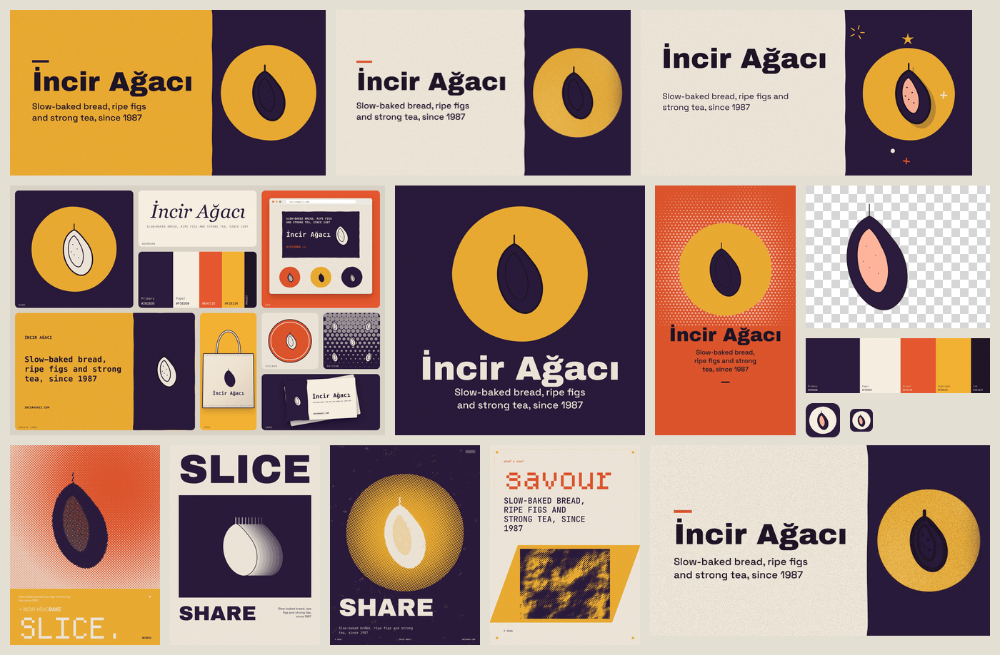

# Brand kit

One small brand spec becomes a whole folder of assets that look like one family: a mark, favicons, a palette, social
cards, a story, a README banner, a brand board, posters and a short loop. Same inks, same mark, same finish in every
file. No image model, no network, no account: it runs locally and is deterministic by seed.

Use it when a project has no assets and you still need a first, consistent set. If you only have a website, read the
name, tagline and colours from the page first (`brandFromUrl`, below).



## Make a kit

```
levni brand <brand.json | https://url> <out-dir> [--posters 8] [--only og,cover,board]
```

API: `import { renderKit, expandKit, brandFromHtml, brandFromUrl } from '@levni/levni'`. MCP: `render_brand_kit`.

```json
{
  "brand": {
    "name": "İncir Ağacı",
    "tagline": "Slow-baked bread, ripe figs and strong tea, since 1987",
    "inks": ["#2B1B3D", "#E4572E", "#F2B134", "#F5EDE0"],
    "words": ["Bake", "Slice", "Share", "Savour"]
  },
  "seed": 12,
  "posters": 4
}
```

That is [`examples/brandkit.json`](../examples/brandkit.json). Only `name` is required.

| field | default | meaning |
| --- | --- | --- |
| `brand.name` | required | up to 40 characters; long names wrap to two or three lines on the cards |
| `brand.tagline` | none | one short line (90 characters) |
| `brand.mark` | picked | a library prop (`levni list <word>`). Without it one is picked from the name and tagline, the same one every time |
| `brand.inks` | seeded set | 1 to 5 `#RRGGBB`. The darkest becomes the primary, a very light one the paper; missing accents get a pleasant default. The kit stores the four it resolved (primary, accent, highlight, paper) in `brand.json` |
| `brand.words` | from the tagline | up to four headline words for the posters |
| `seed` | from the name | texture seed |
| `only` | all | asset names to make: `mark`, `favicon`, `palette`, `og`, `cover`, `social-square`, `story`, `readme-banner`, `board`, `posters`, `loop` |
| `posters` | 4 | `8` renders every poster template |

## What you get

```
out-dir/
  mark.png  mark.svg        1024 px, transparent background
  favicon-32.png  favicon-180.png
  palette.png               the five inks with hex values
  og.png                    1200 x 630
  cover.webp                1200 x 673
  social-square.png         1080 x 1080
  story.png                 1080 x 1920 (type stays out of the app bars)
  readme-banner.png         1280 x 640
  board.png                 the nine-tile brand board (docs/board.md)
  posters/                  4 (or 8) posters and series.png (docs/poster.md)
  loop.webp                 30-frame loop of the cover, 600 px: the name types itself, the mark pops in and floats
  brand.json                the resolved brand: name, tagline, mark, inks, words, seed
  kit.json                  every file with bytes, pixel size and the scene that drew it
  index.html                one static page that shows the whole kit in the brand's own inks
```

A full kit is about 15 MB and takes roughly 15 CPU seconds on an M-series Mac (the board and the posters are most of
it). Render only what you need with `--only`. Every `.png` is a normal scene (or board, or poster spec) saved in
`kit.json`, so any asset can be edited and re-rendered with `levni render`, `levni board` or `levni poster`.

`renderKit` returns `{ files, brand, notes, ms }`; `notes` holds the layout critic's remarks per asset. `expandKit(spec)`
returns the same list without rendering anything.

## From a website

```js
import { brandFromUrl, renderKit } from '@levni/levni';
const found = await brandFromUrl('https://example.com');   // { name, tagline, inks, source }
await renderKit({ brand: found }, 'kit/');
```

`brandFromHtml(html, url)` is the pure part: it reads `og:site_name`, `application-name` or the `<title>`, the meta
description, `theme-color`, `msapplication-TileColor`, CSS custom properties and the most frequent colours in inline
`<style>` blocks and `style` attributes. Whites, blacks and greys are dropped and near-duplicates merged, leaving three
or four inks ordered by prominence. With fewer than two real colours it falls back to a seeded palette and says so in
`source.inks` and `source.notes`.

`brandFromUrl` fetches exactly the one URL you give (redirects followed, 10 s timeout, HTML only, at most 2 MB, no
cookies, user agent `levni-brandkit`) and nothing else: no stylesheets, no images, no other pages. It throws a plain
error when the page cannot be read. Colours that live only in external stylesheets are not seen, so check the result
and pass `inks` yourself when a site hides its palette that way.

## Limits

- `board.png` is tuned for names up to about 14 characters; a longer name is shortened to its first words there (the
  note says so). Every other asset sets the full name.
- The mark is one library prop drawn in the brand's inks. It looks best when you choose it (`levni list`).
- The mark on the cards is drawn in a single ink so it reads on any ground; `mark.png` and the banner keep its colours.
- `loop.webp` is skipped, with a note, if nothing in the scene moves.
