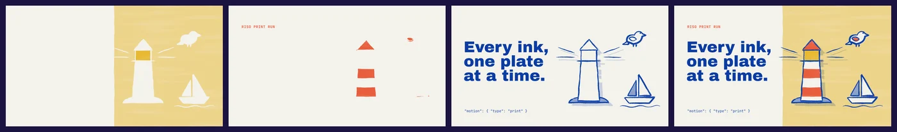

# Print

`levni print` splits a scene into riso plates: one grayscale image per ink, ready for a stencil printer. The picture on
your screen and the print on paper come from the same JSON.



```bash
npx @levni/levni print scene.json print/
npx @levni/levni print scene.json print/ --scale 4 --plates 3 --halftone 4
```

```js
import { separate } from '@levni/levni';
const r = await separate(scene, 'print/', { scale: 3, plates: 4 });
// r.plates: [{ order, ink, hex, file, coverage }], r.dpi: { a4, a3 }
```

From an agent: the MCP tool `render_print` takes the same scene and returns the plate list and the sheet.

## What lands in the folder

```text
print/
  plate-1-mustard.png   one grayscale image per drum: black is full ink, gray is a tint, white is paper
  plate-2-coral.png     lightest ink first, the darkest (usually the key line) last: the order to print them
  plate-3-blue.png
  proof.png             the plates multiplied back on the paper colour: what the print should look like
  sheet.png             each plate printed alone in its ink, then the proof
  print.json            size, dpi at A4 and A3, paper, and per plate its ink, hex, coverage and order
```

## How the plates are found

A Levni picture is already printed in a few flat inks and their tints, so each pixel is read as "this much of one ink
on paper".

- **The paper** is the scene's `background` (or `--paper`).
- **Inks that are close** share a drum: the ink outlines and the blue fills become one blue plate.
- **A pale colour** on the line from paper to an ink is that ink at a lower density: `tone` prints as blue at part
  density, `tone-mustard` as mustard.
- **Two inks over each other** (a shadow on a coloured panel) go onto both plates, each at its own density.
- **More inks than drums** (`--plates`, default 4): the least used ink folds into the plate nearest in colour.
- **Motion is ignored**: entrances show their finished state, the camera stands still.

## Options

| option | default | meaning |
| --- | --- | --- |
| `scale` | `3` | pixels per canvas unit: a 1200 x 673 cover becomes 3600 x 2019, about 300 dpi across an A4 |
| `plates` | `4` | most drums to use |
| `halftone` | none | screen the tints into dots of this many px. Leave it out to keep gray and let the printer screen |
| `paper` | the background | the colour treated as paper |
| `shift` | `0` | misregister the plates in the proof by this many px, to see the print with a loose registration |
| `merge` | `48` | inks closer than this share a drum |

## Printing

Load each plate on the drum of its ink, in the order of the file names. The proof assumes translucent riso inks over
the paper colour; your real inks will differ a little from the screen colours. Most riso printers screen gray images
themselves; use `--halftone` when yours does not, or when you want the dots to show.
