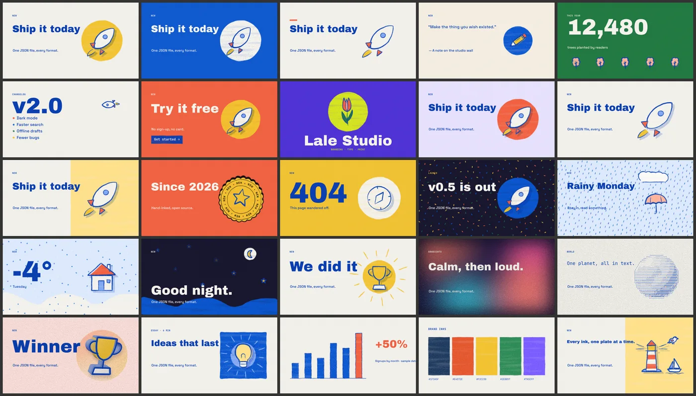

# Shots

A shot is a ready-made piece of motion with slots: a title, a subtitle, a kicker, a drawing from the Folio and your
inks. Fill the slots and Levni draws the loop. Every shot lays itself out for every format.



```bash
npx @levni/levni shot --list
npx @levni/levni shot logo-sting sting.gif --title "Lale Studio" --mark tulip --format square
npx @levni/levni shot list-stagger notes.mp4 --title "v2.0" --items "Dark mode,Faster search,Offline drafts"
npx @levni/levni shot bars-grow chart.webp --title "+50%" --values "3,5,4,7,6,9" --inks "#1F3A5F,#E4572E"
```

```js
import { shotScene, animate } from '@levni/levni';
const scene = shotScene('logo-sting', { title: 'Lale Studio', mark: 'tulip', format: 'story' });
await animate(scene, 'sting.gif', { frames: 36 });
```

From an agent: the MCP tool `render_shot` takes `name`, `fields` and `out`, and lists every shot when called with no name.

## Fields

| field | meaning |
| --- | --- |
| `title` | the headline (a number for `big-number`, a quote for `quote`) |
| `subtitle` | one line under it |
| `kicker` | a small upper-case label at the top |
| `mark` | a drawing from the Folio by name (`levni list` to search) |
| `inks` | up to five hex colours: they replace blue, coral, mustard, green and ink everywhere in the shot |
| `items` | lines for `list-stagger` |
| `values` | numbers for `bars-grow` |
| `cta` | the button text for `cta-pop` |
| `format` | `cover` (default), `og`, `square`, `story`, `youtube`, `hd`, `readme` |

A field you leave out takes the shot's own sample, so every shot draws something with no fields at all.

## Outputs

The file name picks the output: `.gif` or `.webp` (a loop, 36 frames at 12 fps), `.mp4` (needs ffmpeg), `.png` (the
finished still) or `.json` (the scene: change anything and render it with `levni animate`). `--width`, `--frames` and
`--fps` work as in `levni animate`.

## Every shot

| shot | kind | what moves |
| --- | --- | --- |
| `typed-headline` | text | The headline types itself while the mark pops in and floats. |
| `headline-slide` | text | Headline and subtitle slide in from the left on a blue ground. |
| `kicker-wipe` | text | A coral bar wipes in, the headline is uncovered, the mark is drawn on. |
| `quote` | text | A quote types itself in serif; the attribution fades in after. |
| `big-number` | data | A number types itself; a row of drawings sways underneath. |
| `list-stagger` | text | A title, then a list whose lines slide in one after another. |
| `cta-pop` | text | A headline, then a button that pops in and pulses. |
| `logo-sting` | mark | A disc and the mark pop in, the name types itself, a line fades in. |
| `mark-float` | mark | The mark floats over a breathing disc, the title below. |
| `mark-draw` | mark | The mark is drawn on line by line, then coloured in. |
| `mark-print` | mark | The mark is printed like a riso run, one ink plate at a time. |
| `seal-spin` | mark | A seal with the mark at its centre turns slowly. |
| `error-wiggle` | mark | A big title and a mark that shakes: 404s, empty states. |
| `confetti-launch` | scene | Confetti falls on a dark card; the mark pops in and the title types. |
| `rain` | scene | Rain falls past a drifting cloud: weather, mood, a slow day. |
| `snow` | scene | Snow falls over a still drawing on pale hills. |
| `night` | scene | Stars blink out of step over dark hills; the moon floats. |
| `sunburst` | scene | Rays turn behind the mark; a bright hero for good news. |
| `mesh-breathe` | scene | A dark mesh gradient breathes behind a typed title. |
| `ascii-globe` | scene | A globe of text characters turns beside a typed title. |
| `turntable` | scene | The mark as a 3D object, turning once a loop. |
| `camera-push` | scene | A cover where the view slowly pushes in while the mark floats. |
| `bars-grow` | data | Bars rise one after another; the last one is the news. |
| `palette-rise` | data | Brand colour swatches rise one after another, then their codes. |
| `print-run` | mark | Three drawings printed like a riso run, one after another. |

See them all moving at [levni.dev/shots](https://levni.dev/shots/).
