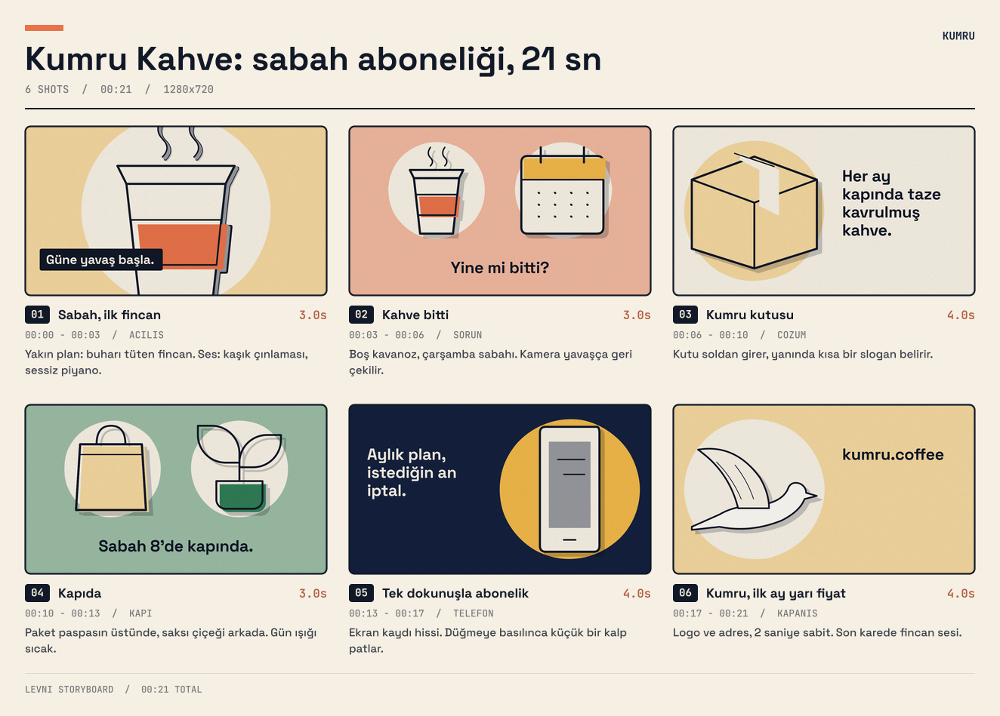

# Storyboards

A storyboard is the picture of a shot list, drawn before anyone renders a video. Give it shots (a prop, a camera, some on-screen words, a duration) and it draws one contact sheet: a numbered frame for every shot with its title, length, running timecode and note. Video tools (Remotion, Blender, an editor) can then read the same frames and `shots.json` instead of guessing.



```
levni storyboard <spec.json> <out.png> [--frames-dir dir] [--columns n]
```

API: `import { expandStoryboard, renderStoryboard } from '@levni/levni/storyboard'`. Deterministic like a scene: the same spec and seed give the same bytes. The labels use the repo's own fonts, so Turkish letters (ğ ş ı İ) draw correctly on every machine. Example: `examples/storyboard.json` (the sheet above).

## A spec

```json
{
  "title": "Kumru Kahve: sabah aboneliği, 21 sn",
  "brand": { "name": "Kumru", "mark": "dove", "inks": ["#14213D", "#E8734A", "#F0B84A", "#F6F0E4"] },
  "format": "youtube",
  "seed": 12,
  "shots": [
    { "id": "acilis", "title": "Sabah, ilk fincan", "prop": "coffee-cup", "camera": "close",
      "text": "Güne yavaş başla.", "note": "Yakın plan: buharı tüten fincan.", "duration": 3 },
    { "id": "sorun", "title": "Kahve bitti", "props": ["coffee-cup", "calendar"], "background": "tone-coral",
      "text": "Yine mi bitti?", "duration": 3 },
    { "id": "cozum", "title": "Kumru kutusu", "prop": "package", "camera": "left",
      "text": "Her ay kapında taze kavrulmuş kahve.", "duration": 4 }
  ]
}
```

A bare array also works, so an existing `shotlist.json` of `{ id, desc, frames }` needs no changes: `desc` is the title, `frames` (24 fps unless the shot or the spec sets `fps`) is the length, and a word in the text that names a prop (`coffee`, `rocket`, `truck`, any tag from `levni list`) picks the drawing. No match gives a neutral placeholder.

| field | default | meaning |
| --- | --- | --- |
| `title` | brand name | sheet title |
| `brand` | none | `{ name, inks, mark }`. `inks` (1-5 colours) re-ink every generated frame and the sheet itself |
| `style` | from `brand` | any Levni style: `"riso"`, `"miniature"` or your own inks. Wins over `brand.inks` |
| `format` | `youtube` | `youtube` (1280x720), `hd` (1920x1080), `story` (1080x1920), `square`, or `[w, h]` |
| `fps` | `24` | used to turn `frames` into seconds |
| `seed` | from the title | crayon texture; each shot adds its own offset |

Per shot:

| field | meaning |
| --- | --- |
| `id`, `title` (or `desc`), `note` | label, headline and the longer text under the frame |
| `duration` (seconds) or `frames` (+ `fps`) | length. `duration` wins. Default 3 s |
| `scene` | a full [Levni scene](scene.md), used as is (reflowed into the format when authored for another size) |
| `prop` / `props` | a Folio prop name or tag, or up to four of them |
| `background` | a colour name (`paper`, `blue`, `tone-coral` ...). Default cycles through soft grounds |
| `camera` | `wide` (centred, text below), `close` (big, cropped, caption on a block), `left` / `right` (prop to that side, text opposite) |
| `text` | on-screen words drawn into the frame |

Unknown prop names never throw. The frame becomes a placeholder (an outlined frame crossed out, with the shot text) and the message lands in `warnings`. Unknown cameras and backgrounds warn too.

## Outputs

```js
const shots = expandStoryboard(spec);   // [{ id, title, note, duration, scene, warnings }], plain JSON
const r = await renderStoryboard(spec, 'story.png', { columns: 3, frameWidth: 400, framesDir: 'frames' });
// r: { png, width, height, shots, total (seconds), warnings }
```

`expandStoryboard` is the shot list as scenes: print one, edit it, render it with `levni render`. `renderStoryboard` writes the sheet. With `framesDir` it also writes `shot-01.png` ... at the full format size and `shots.json`:

```json
[{ "id": "acilis", "title": "Sabah, ilk fincan", "note": "Yakın plan: ...", "duration": 3, "start": 0, "file": "shot-01.png" }]
```

`start` is the running time in seconds, so a video tool can place every frame on a timeline. Shots that came with `frames` also keep that count.

| option | default | meaning |
| --- | --- | --- |
| `columns` | 3 (4 for tall formats) | frames per row |
| `frameWidth` | 360 | thumbnail width on the sheet; text scales with it |
| `framesDir` | none | folder for the full-size frames and `shots.json` |

Each frame is a normal scene drawn at the full size (about one second per shot), then scaled for the sheet. Up to 60 shots; long notes are cut at four lines with `...`.
